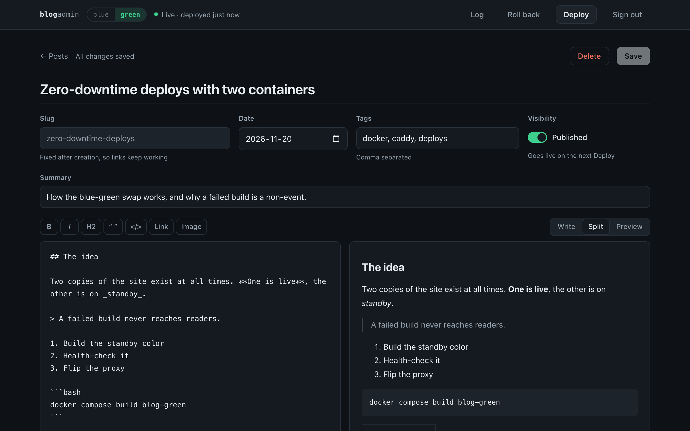
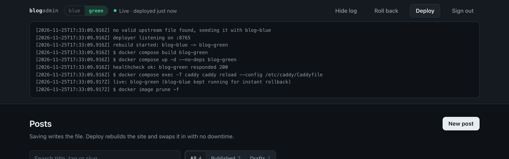
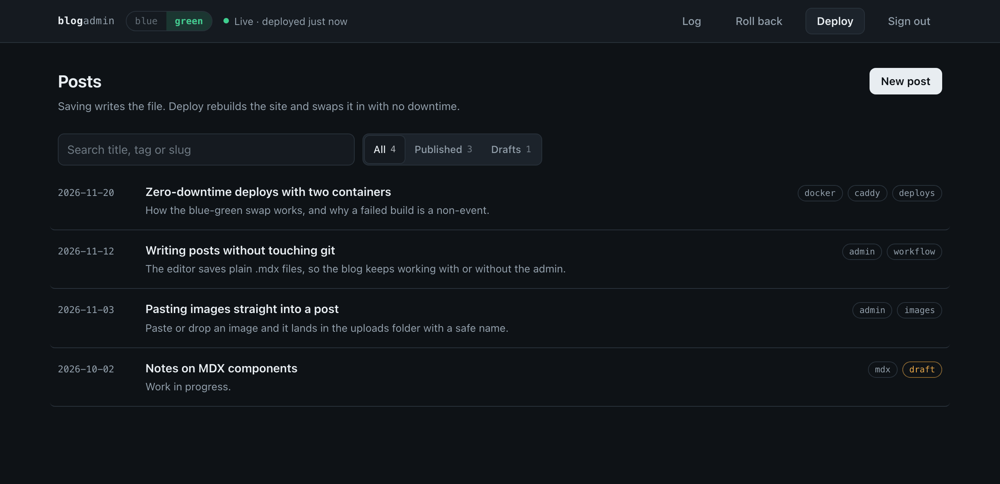
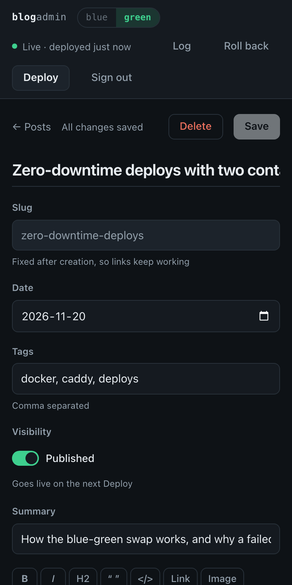

# Blue-Green Admin for Tailwind Nextjs Starter Blog

[](LICENSE)
[](https://github.com/Alabaich/tailwind-nextjs-starter-blog-admin/actions/workflows/ci.yml)
[](https://nextjs.org)
[](admin/tsconfig.json)
[](docker-compose.yml)

A self-hosted admin panel and zero-downtime publishing pipeline for
[timlrx/tailwind-nextjs-starter-blog](https://github.com/timlrx/tailwind-nextjs-starter-blog) —
without forking it.

The starter is the most feature-rich Next.js markdown blog template out there:
SEO, sitemaps, RSS, MDX, perfect Lighthouse scores. Its one gap is that
publishing means editing `.mdx` files and pushing to git. This overlay adds the
missing piece: a login-protected admin where a non-technical author writes a
post, presses **Deploy**, and the site rebuilds behind the scenes with
**blue-green container swaps** — the live site never goes down, the new post
simply appears a minute or two later.

## Overview

The editor: Markdown on the left, live sanitized preview on the right, and the
deploy rail on top showing which color is live.



The deploy rail with its log open after a deploy. **Roll back** flips traffic
to the previous release without rebuilding.



| Post list with search and draft filter | On a phone |
| --- | --- |
|  |  |

How the pieces fit together:

```
                 ┌───────────┐   writes .mdx    ┌──────────────────┐
   author ──────▶│   admin   │─────────────────▶│  site/data/blog  │
                 │  (:8081)  │                  └──────────────────┘
                 └─────┬─────┘                            │ build context
                       │ POST /rebuild                    ▼
                 ┌─────▼─────┐  docker build     ┌────────────────────┐
                 │  deployer │──────────────────▶│ blog-blue / green  │
                 └─────┬─────┘   healthcheck     └────────┬───────────┘
                       │ flip upstream + reload           │
                       │ (or roll back to the old color)  │
                 ┌─────▼────────────────────────┐         │
   readers ─────▶│           caddy (:80)        │◀────────┘
                 └──────────────────────────────┘
```

## Design principles

- **The starter stays stock.** `setup.sh` clones upstream into `./site/` and
  adds exactly two files: a `Dockerfile` and a `.dockerignore`. No theme
  changes, no schema changes, no fork. `git pull` inside `site/` keeps you on
  upstream.
- **Files are the source of truth.** The admin writes plain `.mdx` with the
  starter's own frontmatter (`title`, `date`, `tags`, `draft`, `summary`) and
  leaves every other field in the file alone. No database for content — you can
  stop using this overlay tomorrow and your blog still works.
- **Immutable deploys.** Content is baked into the image at build time. The
  standby color is built, health-checked, then Caddy's upstream is flipped
  with a graceful reload. The previous color keeps running for one-click
  rollback.
- **Failed builds are non-events.** If a build breaks, the live site keeps
  serving traffic and the admin shows the build log.
- **Least privilege.** Only the deployer holds the Docker socket. The admin
  talks to it over the internal network with a shared token.
- **Refuses to run insecurely.** Placeholder secrets and weak admin passwords
  stop the services at boot instead of quietly working.

## Quickstart

Requirements: Docker with Compose v2 and BuildKit (any recent Docker).

```bash
git clone <this-repo> && cd <this-repo>
./setup.sh                    # clones the starter, generates secrets + admin password
$EDITOR .env                  # set ADMIN_EMAIL
docker compose up -d --build  # first build takes a few minutes
```

- Blog: `http://localhost:8080`
- Admin: `http://localhost:8081` (published on loopback only, see
  [Production notes](#production-notes))

`setup.sh` prints the generated admin password once; it is also in `.env`.

Write a post, press **Save**, then **Deploy** in the top rail. The rail shows
which color is live, whether there are unpublished changes, the build state,
and the log.

## How a deploy works

1. Admin saves the post to `site/data/blog/<slug>.mdx` (bind-mounted).
2. Admin calls the deployer's `POST /rebuild`.
3. Deployer builds the **standby** color. The Dockerfile caches the dependency
   layer and persists `.next/cache` via a BuildKit cache mount, so rebuilds
   after a new post are fast.
4. Deployer starts the new container and polls it until it answers with a
   2xx/3xx. A build that comes up returning errors never receives traffic.
5. Deployer rewrites the upstream snippet Caddy imports and gracefully reloads
   Caddy. Traffic flips with zero downtime. If the reload fails, the snippet is
   put back so the recorded state always matches what Caddy is serving.
6. The old color stays up as the rollback slot until the next deploy.

Rebuild requests that arrive mid-build are coalesced into a single follow-up
run, so saving three posts in a row costs one extra build, not three.

Which color is live (`active.caddy`) and the rollback state live in the
`upstream_state` Docker volume, owned by the deployer and mounted read-only
into Caddy. Runtime state never touches the git working tree.

## Rollback

After a successful deploy the rail shows **Roll back**. It health-checks the
previous color and flips Caddy back to it — no build, done in about a second.

- Rollback swaps containers; it does not touch your post files. The next
  **Deploy** publishes whatever is on disk.
- The release you rolled away from becomes the standby, so you can switch
  forward again.
- The button only appears when the standby really holds the previous healthy
  release. A build that failed its health check has replaced the standby, so
  there is nothing safe to roll back to until the next good deploy.

To undo a change to the *content* rather than the release, use the
[content history](#content-history).

## Security

The details and the threat model are in [SECURITY.md](SECURITY.md). In short:

- Login is bcrypt-hashed, rate limited per client IP, and never reveals
  whether an email exists.
- Sessions are HMAC-signed, `HttpOnly`, `SameSite=Lax` cookies, marked
  `Secure` when served over HTTPS.
- Every state-changing request must come from the admin's own origin (CSRF
  protection that also covers the blog on the same host).
- Uploads are identified by their content, not their name, and are size
  limited. SVG is rejected.
- The markdown preview is sanitized, and the admin sends a Content Security
  Policy plus the usual hardening headers.
- `SESSION_SECRET` / `DEPLOY_TOKEN` placeholders or values under 32 characters,
  and admin passwords under 12 characters, stop the services at boot.

## Configuration

All settings live in `.env` (created by `setup.sh` from `.env.example`).

| Variable | Default | Purpose |
| --- | --- | --- |
| `COMPOSE_PROJECT_NAME` | `bluegreen-blog` | Must stay stable: the deployer addresses the stack by it. |
| `BLOG_PORT` | `8080` | Host port for the blog. |
| `ADMIN_PORT` | `8081` | Host port for the admin. |
| `ADMIN_BIND` | `127.0.0.1` | Host interface the admin port is published on. |
| `ADMIN_EMAIL` | — | Admin login. Seeded on first boot only. |
| `ADMIN_PASSWORD` | generated | 12+ characters. Seeded on first boot only. |
| `SESSION_SECRET` | generated | Signs session cookies. Rotating it signs everyone out. |
| `DEPLOY_TOKEN` | generated | Shared secret between admin and deployer. |
| `MAX_UPLOAD_MB` | `8` | Per-image upload limit. Caddy caps request bodies at 25 MB. |

The admin account is created once, when the database is empty. To change the
password afterwards, remove the `admin_db` volume and start again with the new
value in `.env` (the volume only holds the account; posts are files).

## Production notes

- **The admin is not exposed by default.** The bundled Caddyfile serves it over
  plain HTTP, so compose publishes it on `127.0.0.1` only. Either reach it
  through an SSH tunnel (`ssh -L 8081:localhost:8081 your-server`), or put it
  behind TLS and then set `ADMIN_BIND=0.0.0.0`.
- **TLS.** Point your domains at the host, replace `:80` and `:8081` in
  `caddy/Caddyfile` with the blog and admin hostnames, and publish ports
  `80:80` and `443:443` on the `caddy` service. Caddy obtains certificates
  automatically, and the session cookie becomes `Secure`. Keep the admin on its
  own hostname and consider restricting it by IP.
- `COMPOSE_PROJECT_NAME` in `.env` must not change after first boot — the
  deployer relies on it to address the stack from inside its container.
- Dangling images from superseded builds are pruned after each successful
  deploy (`PRUNE_IMAGES=0` on the deployer turns that off). Images still used
  by a container, including the rollback slot, are never removed.

## Content history

Every save, delete, and image upload creates a local git commit inside
`site/` (authored as `blog-admin`), so a fat-fingered save or delete is never
final:

```bash
cd site
git log --oneline -- data/blog          # what changed and when
git show HEAD~1:data/blog/my-post.mdx   # read an older version
git checkout HEAD~1 -- data/blog/my-post.mdx  # restore it, then Deploy
```

History is best-effort by design: if git is unavailable the save still goes
through, it just isn't recorded.

## Updating the starter

```bash
cd site && git pull --rebase
```

Your content commits are local, so a rebase replays them on top of upstream.
Content lives in `site/data/blog/` and uploads in
`site/public/static/images/uploads/` — upstream rarely touches those paths.
After pulling, press **Deploy** to rebuild on the new version.

## Development

Both services are strict TypeScript.

```bash
cd admin    && npm ci && npm run typecheck && npm test && npm run build
cd deployer && npm ci && npm run typecheck && npm test
```

- `admin/` is a Next.js 15 app. Tests run on Vitest and cover slugs, post
  storage, sessions, the CSRF guard, rate limiting, upload validation, and the
  account seed.
- `deployer/` has no runtime dependencies and no build step: Node runs the
  TypeScript sources directly. The whole blue-green state machine takes its
  side effects (docker, HTTP probes, files, clock) as injected dependencies, so
  it is tested with `node --test` and no Docker.

CI runs all of the above, validates the compose file and Caddyfile, lints
`setup.sh`, and builds both images.

## Upgrading from 0.1.0

```bash
git pull
./setup.sh                    # refreshes the files copied into site/
docker compose up -d --build  # rebuilds every service, including both colors
```

- The live-color state moved from `caddy/upstream/active.caddy` in the working
  tree to a Docker volume. `--build` rebuilds both colors from the current
  content, so starting again from blue is safe.
- The admin port is now published on `127.0.0.1` only. Set `ADMIN_BIND=0.0.0.0`
  in `.env` to keep the old behavior (behind TLS, please).
- Secrets under 32 characters and admin passwords under 12 are rejected at
  boot. An existing account keeps working whatever its password length; the
  password check applies when the account is first created.
- SVG uploads are no longer accepted. Existing files keep working.

## Known limitations

- Posts in subfolders of `data/blog` (the starter's nested routes) are not
  listed in the admin.
- One admin account. Sessions are stateless: signing out clears the cookie,
  but a copied cookie stays valid until it expires (7 days) or
  `SESSION_SECRET` is rotated.
- The login rate limit is in memory and resets when the admin restarts.

## Roadmap

- Multi-user accounts and roles
- Author and page (about/projects) editing
- Nested post folders

## Contributing

Bug reports, feature requests, and PRs are welcome — see
[CONTRIBUTING.md](CONTRIBUTING.md). This project follows the [Contributor
Covenant](CODE_OF_CONDUCT.md).

## Security

Found a vulnerability? Please don't open a public issue — see
[SECURITY.md](SECURITY.md) for how to report it privately.

## Credits

Built on top of [timlrx/tailwind-nextjs-starter-blog](https://github.com/timlrx/tailwind-nextjs-starter-blog),
without which this project wouldn't have a blog to publish to. The SEO,
sitemap, RSS, and MDX work is all upstream's — this repo only adds the admin
and the deploy pipeline around it.

## License

[MIT](LICENSE) © Oleksandr Tsybulskyi
